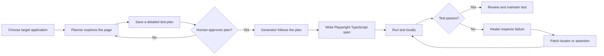
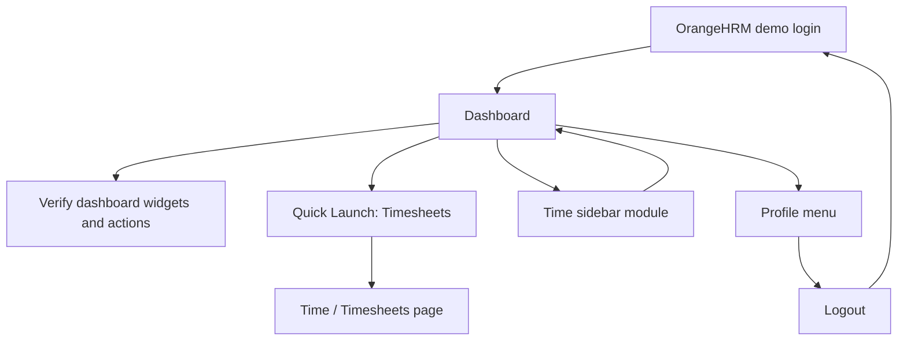

# Playwright MCP Agents

An example Playwright Test project that combines GitHub Copilot agents with the Playwright MCP server to plan, generate, run, and repair browser tests. The included end-to-end examples exercise the public OrangeHRM demo.

> **Demo environment:** Tests use the externally hosted OrangeHRM demo at `https://opensource-demo.orangehrmlive.com`. It is not controlled by this project and may be slow, unavailable, or change without notice. The demo credentials are displayed on its login page; avoid relying on dynamic employee, post, or dashboard data.

## What’s inside

| Component | Purpose |
| --- | --- |
| Playwright Test | Runs TypeScript browser tests with Chromium |
| Playwright MCP server | Exposes browser and test tools to compatible MCP clients |
| Planner agent | Explores a web application and writes a step-by-step test plan |
| Generator agent | Turns an approved plan into a Playwright spec |
| Healer agent | Investigates failing tests and proposes targeted repairs |
| OrangeHRM examples | Demonstrate dashboard checks, navigation, Quick Launch, and logout |

### Agent workflow

The agents are intended to be used in sequence, with a human reviewing and approving the plan before code generation:



### Test coverage in this repository



## Requirements

- Node.js LTS and npm
- VS Code with a compatible MCP client for the editor-integrated agents
- Internet access to install npm packages, download Chromium, and reach the OrangeHRM demo

## Getting started

Clone the repository and install its locked dependencies:

```bash
git clone https://github.com/akshayupadhayay/playwrightMCPagents.git
cd playwrightMCPagents
npm ci
npx playwright install chromium
```

On Linux CI machines, install browser system dependencies as well:

```bash
npx playwright install --with-deps chromium
```

## Run tests

Run all configured tests:

```bash
npm test
```

The OrangeHRM demo is a shared public service. To avoid competing logins and reduce intermittent failures, run the four demo tests one worker at a time:

```bash
npx playwright test --project=chromium --workers=1
```

Run one test file:

```bash
npx playwright test tests/orangehrm-dashboard.spec.ts --project=chromium --workers=1
```

Run a test with a visible browser:

```bash
npx playwright test tests/orangehrm-dashboard.spec.ts --project=chromium --headed
```

Run the local seed test:

```bash
npm run test:seed
```

The project is configured for Chromium in [`playwright.config.ts`](./playwright.config.ts). Tests are discovered in `tests/` and use the `chromium` project.

## HTML report

Generate a Playwright HTML report:

```bash
npx playwright test --project=chromium --workers=1 --reporter=html
```

Open the report in a browser:

```bash
npx playwright show-report
```

The generated report is written to `playwright-report/`. Test results are written to `test-results/`; both directories are excluded from Git.

## VS Code MCP setup

The workspace MCP configuration is in [`.vscode/mcp.json`](./.vscode/mcp.json). It starts the Playwright Test MCP server through `npx`:

```json
{
  "servers": {
    "playwright-test": {
      "type": "stdio",
      "command": "npx",
      "args": ["playwright", "run-test-mcp-server"]
    }
  },
  "inputs": []
}
```

Open this repository in VS Code and enable or start the `playwright-test` MCP server when prompted. The server is a local stdio process managed by the MCP client; it is not an HTTP service that needs to be left running in a separate terminal.

The agent definitions in `.github/agents/` refer to this MCP server and its browser/test tools:

- **playwright-test-planner** — inspect the target application and save a test plan.
- **playwright-test-generator** — explore the approved scenario and write a spec.
- **playwright-test-healer** — run and debug failed tests, then make focused fixes.

If the MCP test runner cannot load the seed test in your environment, you can still run tests from the terminal with the commands above. Keep the seed as a single small environment setup test, and ensure the test directory in `playwright.config.ts` matches where specs are stored.

## Adding a test with the agents

1. Ask the planner to inspect the target application and outline scenarios, expected results, and assumptions.
2. Review the saved plan and approve or request changes before implementation.
3. Ask the generator to follow the approved scenario and create one spec per test case.
4. Run the new spec locally. Use `--headed` when you need to observe browser behavior.
5. If it fails, provide the terminal output to the healer. Check the diagnosis and rerun after its patch.

Prefer role- and label-based locators such as `getByRole()` and `getByLabel()`. Avoid assertions against volatile values unless the test specifically covers those values.

## Project layout

```text
.
├── .github/
│   ├── agents/
│   │   ├── playwright-test-generator.agent.md
│   │   ├── playwright-test-healer.agent.md
│   │   └── playwright-test-planner.agent.md
│   └── workflows/
│       └── copilot-setup-steps.yml
├── .vscode/
│   └── mcp.json
├── specs/
│   ├── README.md
│   └── orangehrm-dashboard.plan.md
├── tests/
│   ├── orangehrm-dashboard-logout.spec.ts
│   ├── orangehrm-dashboard-sidebar-navigation.spec.ts
│   ├── orangehrm-dashboard.spec.ts
│   ├── orangehrm-quick-launch-timesheets.spec.ts
│   └── seed.spec.ts
├── package.json
├── package-lock.json
└── playwright.config.ts
```

## Existing OrangeHRM scenarios

- **Dashboard overview** — login and check stable dashboard widget headings, distribution sections, and Quick Launch actions.
- **Quick Launch Timesheets** — open Timesheets from the dashboard and verify the destination.
- **Sidebar navigation** — move into the Time module and return to the dashboard.
- **Logout** — open the profile menu, log out, and verify the login screen returns.

The detailed steps and expected results are documented in [`specs/orangehrm-dashboard.plan.md`](./specs/orangehrm-dashboard.plan.md).

## Reliability notes

- Treat demo data as mutable; assert stable labels and navigation rather than specific employee names, post text, counts, or time values.
- Sequential execution is recommended for the public demo because parallel tests share a service and may race during authentication.
- Do not add private credentials, cookies, or authenticated storage state to the repository. Use a test environment and secret store for applications that require private credentials.
- Keep generated outputs out of commits. The repository `.gitignore` already excludes `node_modules/`, `playwright-report/`, and `test-results/`.
